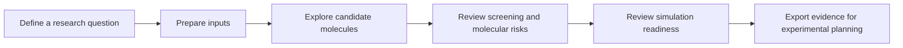

# Yuanhe Bio · 元核生物

**Evidence-led molecular discovery workflows.**

[中文介绍](README.zh-CN.md) · [Product overview](docs/PRODUCT.md) · [Access and publication policy](docs/ACCESS.md)

Yuanhe Bio connects molecular design, virtual screening, molecular risk review and molecular dynamics preparation in a research workbench. It helps researchers organize computational evidence and prioritize candidates for further investigation.

## Product experience

This diagram illustrates the user journey; it is not a computed result or an execution guarantee.

| Capability | Researcher-facing outcome |
|---|---|
| Molecular design | Candidate exploration with traceable molecular identities |
| Virtual screening | Candidate prioritization with reviewable supporting evidence |
| Toxicity and synthesis assessment | Computational risk flags and feasibility evidence for expert review |
| Membrane-system preparation | Reviewed membrane context and simulation preparation |
| Molecular dynamics | Simulation workflows and analysis with recorded provenance |
| Research workbench | Organized inputs, run states, review and exports |

## Availability and evidence

The platform is under research development. Capabilities depend on configured computational environments, licensed assets and target-specific validation. Computational scores are not experimental activity, toxicity clearance or a guarantee of successful synthesis. No clinical performance, hit-rate advantage or production service-level commitment is claimed here.

## Discuss a project

Use [public project inquiries](https://github.com/lzylumos-sudo/yuanhe-bio-product/issues) for nonsensitive questions and collaboration interest. Arrange a private channel before sharing unpublished structures, molecule libraries, results or commercial information. Evaluation, deployment and licensing scope are agreed separately.

This repository contains product information only. Research implementations, internal configurations, models and operational documentation are maintained privately. Third-party methods retain their own authorship and terms; historical license grants are not revoked by this publication boundary.
